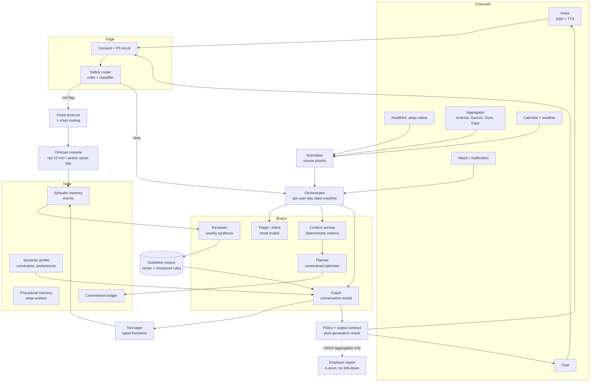

# Rhythm — Design of a Daily Health & Wellness Agent

**Status:** concept design (v0.3 — all decisions locked, ready for build) · **Scope:** wellness, not medical care · **Platform fit:** Kitabati voice + LLM endpoints (FastAPI / Ray Serve)

---

## 0. Decisions locked

| # | Decision | Choice | What it costs us |
|---|---|---|---|
| **D1** | Go-to-market | **B2B2C** — employer/insurer pays, employee uses | Two customers, a hard privacy wall, and a procurement-shaped roadmap |
| **D2** | Wearables | **Hybrid** — one deep native integration *plus* an aggregator | Breadth on day one, plus a per-connected-user vendor bill and a second normalisation path |
| **D3** | Clinical | **Clinician in the loop at launch** | A real clinical tier with an SLA and a staffing cost — and a much stronger safety and procurement story |
| **D4** | Language | **English-first, Arabic in the same release** — parallel authoring track, per-cohort defaults (see 0.4) | Arabic authored *alongside* English, never machine-translated; ASR/TTS still benchmarked on Gulf speech |

**Net effect on the plan: 8 weeks → 14 weeks.** The extra time is clinical protocol authoring and the DPA; English-first moves Arabic off the critical path, so the last two weeks are buffer the pilot will want anyway. That is the honest trade for these four choices.

### 0.1 What B2B2C actually changes (D1)

The user stays Hana. The *customer* becomes a benefits or wellbeing lead with a budget, a renewal date, and a board slide.

Three consequences run through the whole document:

1. **A privacy wall, not a privacy policy.** The payer sees cohort-level outcomes only — never an individual's sleep, mood, or adherence. This is the single most important architectural constraint in the system (see §11.1). Get it wrong once and the product is unsellable in the region.
2. **The metric that renews the contract is aggregate behaviour change**, not DAU. That conveniently matches §10's "engagement is not a success metric" — for once the ethical choice and the commercial one agree.
3. **Procurement is the critical path, not the code.** A GCC enterprise deal needs a DPA, a security review, data-residency evidence, and often a works-council or HR consultation. Start it in week 1, in parallel, or the 14-week plan is really a 26-week plan.

### 0.2 Why hybrid wearables is the right call (D2)

| Layer | Choice | Role |
|---|---|---|
| **Deep native** | **Apple HealthKit** | Source of truth on iOS. On-device, zero cloud cost, gives sleep stages, HRV, workouts, and — crucially — the *timing* granularity the Rhythm feature needs |
| **Aggregator** | Terra / Vital / Rook class | Breadth: Android (Health Connect), Garmin, Oura, Fitbit, Samsung, Huawei — one integration instead of six |

The architectural rule that makes this safe:

> **The aggregator is a convenience layer; the native path is the source of truth.** Every signal carries `source` and `confidence`, and a resolution table decides which wins when two sources disagree. A missing night is `unknown`, never `zero`.

Two cost realities to design around: aggregators typically bill **per connected user per month**, so connect the aggregator *after* the user commits to a first action, not at signup (activation-gated connection cuts the bill by 60–70%). And one deep integration is a permanent maintenance cost — Apple ships an OS every September.

### 0.3 Clinician in the loop — and what it is *not* (D3)

This upgrades safety from "policy" to "supervision", which is worth a great deal in enterprise procurement. But be precise about the model, because the naive version is unaffordable:

- **The clinician is a backstop, not a filter.** No human reads routine messages. That would add hours of latency and destroy the unit economics.
- **The router still does the work.** Deterministic red-flag detection still runs before generation (§9.1). The clinician receives *escalations*, not traffic.
- **SLA is tiered.** Red: page immediately, human responds within 15 minutes during covered hours. Amber: same business day, async.
- **Staffing estimate:** 0.3–0.5 FTE per 1,000 active users, plus on-call. Validate against real escalation rates in the pilot; this is the number most likely to be wrong.
- **Governance is mandatory:** signed protocols, monthly incident review, and an audit log of every clinical decision. Without these, "clinician in the loop" is a marketing claim.

### 0.4 Language: English-first, Arabic in parallel (D4)

**Decided:** English leads. Arabic ships in the same release as a parallel authoring track — never a deferred translation, never a locale patch. The default locale is a **per-cohort setting**, set when the pilot employer is known.

Why this is coherent rather than a compromise: the evidence base is English, so English authoring is native and fast. Arabic is authored *alongside* it to the same clinical bar, which keeps the market bet alive without betting the pilot on Arabic ASR quality. Nothing about the pilot depends on Arabic; nothing Arabic-shaped gets lost either — corpus, voice and eval tracks run in parallel from week 5.

| Layer | Requirement |
|---|---|
| Corpus | Authored in English (evidence-native); Arabic authored in parallel by a native writer, clinician-reviewed — **not machine-translated** |
| Default | **Per cohort**: English-dominant workforce → English default; Arabic-dominant → Arabic default. Set at onboarding, user-changeable any time |
| Voice | EN voice at launch; AR voice validated on real Gulf speech *before any Arabic-default cohort activates* |
| Register | Arabic: MSA for written guidance, Gulf lexicon for voice; never literal translation of English idiom |
| Food & culture | Arabic food vocabulary and meal rhythm (including Ramadan) as first-class data in both tracks |
| Evaluation | Two separately-scored eval sets: EN gates the pilot; AR gates activation of any Arabic-default cohort |

The rule that saves the most rework survives the flip: **both languages are authored; neither is translated into.** Translated wellness copy is detectable within two sentences and reads as either clinical or condescending — both fatal for a coach.

---

## 1. Topic choice

### The decision

> **Rhythm: a daily energy-and-recovery companion.** It helps one person keep sleep, movement, stress recovery and food *timing* in a workable rhythm — grounded in their actual day, not in a generic plan.

Three behaviours only at launch:

| # | Behaviour | Why this one |
|---|---|---|
| 1 | **Sleep regularity** (same wake window ±45 min) | Highest-leverage, lowest-effort lever; measurable passively; no diet culture risk |
| 2 | **Movement snacks** (3 × 5–10 min, not "go to the gym") | Fits fragmented days; works for heat, shift work, low fitness |
| 3 | **Evening wind-down** (a 20-min down-shift before bed) | Directly affects #1; a stress intervention that isn't "meditate 20 minutes" |

### Why *not* the obvious alternatives

| Option | Why we are not starting there |
|---|---|
| Calorie / weight-loss coach | Crowded, adversarial to food culture, meaningful eating-disorder risk, weakest retention-to-outcome ratio |
| Diabetes / chronic disease management | Real value, but it is a regulated medical device question, not a product question, in most markets |
| Mental-health / therapy bot | Clinical liability, crisis handling, licensing — a different company |
| "All of wellness" super-app | No wedge, no habit loop, no reason to return on day 9 |

### The core thesis

**Wellness apps do not fail on information. They fail on adherence.** Nobody lacks knowledge that sleep and walking are good. What people lack is a *closure mechanism*: something that notices their day, picks the one thing that fits right now, gets a commitment, and follows up without shame.

So we are not building an advisor. We are building a **closer** — an agent that closes the loop between intention and behaviour, once per day, with the smallest possible ask.

That single sentence drives every decision below.

### Target persona for v1

> **The user — "Hana", 32.** Works in a GCC city, knowledge worker, wears a consumer band, calendar is chaotic, bilingual Arabic/English, tries a new wellness app every Ramadan and abandons it in 9 days.

> **The customer — "Omar", 41.** Group wellbeing lead at a 4,000-person employer. Has a per-employee-per-month budget, a renewal date, a board slide about absenteeism, and a legal team that will read the DPA line by line. He never sees Hana's data.

Chosen because: (a) passive signals already exist, so we can coach with near-zero data entry; (b) the environment is genuinely adversarial (summer heat, late meetings, travel, Ramadan) — so *context-awareness* is a real differentiator, not a gimmick; (c) the platform already ships Arabic voice, so voice-first is cheap for us and expensive for competitors; (d) employers already pay for wellness that employees ignore — a product that measurably changes behaviour is a category upgrade, not a new line item.

**The design rule that keeps B2B2C honest:** never optimise anything for Omar's dashboard at Hana's expense. If a feature only exists to make the report look good, it gets cut. The report is a *by-product* of Hana succeeding, not a goal in itself.

### Explicit non-goals (v1)

- No diagnosis, no medication advice, no dosing, no lab interpretation.
- No calorie targets, no weight-loss goals, no "good/bad food" framing.
- No emergency service. Red flags are **routed**, never managed.
- No social feed, no leaderboards, no public streaks.

---

## 2. The problems

Same product, six lenses. The point of this table is that most of these are *not* model problems — they are loop, memory, and policy problems.

### 2.1 The user's view

| Problem | What it actually looks like | Design implication |
|---|---|---|
| Cognitive load | "I already have 40 decisions today" | One suggestion, never a menu |
| Data-entry tax | Logging food for 6 days, then quitting | Passive-first; 1 tap or 10 seconds of voice max |
| Guilt and shame | A broken streak makes the app a reminder of failure | No streaks; consistency score that forgives |
| Plan collapse | One late night destroys a 7-day plan | Re-plan on context change, not on schedule |
| Advice conflict | Watch says rest, app says 10k steps, friend says fasting | One voice, one owner of the plan |
| No felt feedback | "I don't know if any of this works" | Weekly causal review: behaviour → felt outcome |
| Motivation decay | Enthusiasm day 1–5, silence day 9 | Novelty budget + re-contracting at day 7 |

### 2.2 The clinical / safety view

| Problem | Risk | Design implication |
|---|---|---|
| Confident wrong advice | Model invents a supplement, a fast, an exercise for a bad knee | Tool-grounded claims only; provenance tag on every factual sentence |
| Hidden comorbidity | Hypertension, pregnancy, T2D, cardiac history, injury | Hard intake gate; comorbidity-aware rule layer, not prompt-only |
| Eating-disorder risk | "Skip dinner", "burn it off", weight framing | Banned-phrase list + screening; food timing only, never restriction |
| Symptom escalation | "Chest tightness" answered with breathing exercises | Deterministic red-flag router *before* the model speaks |
| Crisis | Suicidal ideation surfaces in a 3am check-in | Fixed crisis protocol with local numbers, human handoff |
| Liability / claims | Marketing says "treats insomnia" | Product copy and agent copy both constrained by a claims policy |

### 2.3 The behavioural-science view

| Problem | Mechanism | Design implication |
|---|---|---|
| Intention–behaviour gap | Knowing ≠ doing | Implementation intentions: *when, where, how long* |
| Friction | 4 taps to log = 0 logs | One-tap confirm; pre-filled from signals |
| Self-efficacy | Success must be *experienced*, not promised | Start below the user's ability, then scale |
| Habit formation | Cues, not motivation | Anchor to existing routines ("after you close your laptop") |
| Relapse | Lapse → abstinence violation → quit | "Restart in one tap", zero penalty language |
| Measurement reactivity | Being watched changes behaviour, then stops | Vary what we ask for; don't instrument everything |

### 2.4 The product / business view (B2B2C)

| Problem | Reality | Design implication |
|---|---|---|
| Two customers, opposite wants | Hana wants to be left alone; Omar wants a dashboard | One product, two surfaces; the dashboard reads only cohort aggregates |
| D7 / D30 cliff | Most wellness apps lose ~70–80% by day 30 | The product *is* the day-7 re-contract, not onboarding |
| Engagement ≠ outcome | High DAU with no behaviour change is theatre | Primary KPI is behaviour, not sessions — and the renewal metric agrees |
| Procurement cycle | GCC enterprise deals run 3–6 months: DPA, security review, residency evidence, HR/works-council | Start procurement in week 1 or the roadmap slips a quarter |
| Data politics | Employees suspect the app reports them to HR | The data wall must be *visible*, not just contractual (§11.1) |
| Trust is fragile | One creepy or wrong message loses the user forever | Consent per data source; "what I know about you" panel |
| Monetisation | Per-seat contracts punish low activation, so both sides want engagement | Price on **activated seats**, not licences — aligns the incentive |
| Support cost | Every escalation is now a clinician's time | Tiered escalation; router absorbs ~95%, clinician sees the rest |
| Renewal evidence | Omar must justify the renewal to finance | Aggregate outcome report, cohort-level, k-anonymised, auto-generated quarterly |

### 2.5 The data / engineering view

| Problem | Reality | Design implication |
|---|---|---|
| Wearable fragmentation | Apple, Garmin, Fitbit, Samsung, Oura, Huawei — different, gappy, delayed | Normalise to a canonical signal schema; treat gaps as *unknown*, never as zero |
| Sparse, noisy data | 4 nights of sleep ≠ a trend | Minimum-n gates; confidence shown, not hidden |
| Latency | A nudge at 21:40 must land at 21:40 | Two-tier: cheap model for timing/classification, big model for conversation |
| Cost per user/day | Frontier model on every heartbeat is unviable | Task-based routing; deterministic code for all arithmetic |
| Privacy | Sleep + mood + location is the most sensitive data a consumer app holds | Minimise, on-device pre-aggregation, per-purpose consent, region residency |
| Multilingual | Arabic + English + code-switching in one sentence | Multilingual embeddings; language follows the user, not the UI |

### 2.6 The equity / access view

| Problem | Reality | Design implication |
|---|---|---|
| Literacy & numeracy | Charts don't help everyone | Voice-first; concrete verbs, no percentages |
| Shift workers | "Sleep 11pm–7am" is nonsense for a nurse on nights | Rhythm is relative to *their* wake time |
| Culture & food | Generic "Mediterranean diet" advice insults the user | Food guidance is timing + culture-local, not a cuisine swap |
| Disability / injury | Step counts are ableist as a success metric | Multiple movement currencies (minutes, mobility, standing) |
| Device poverty | No wearable at all | The agent must work on *self-report + calendar + voice* alone |

---

## 3. Resolving the problems into design principles

Each principle is a *mechanism*, not a slogan.

| # | Principle | Kills which problem | Mechanism in the system |
|---|---|---|---|
| P1 | **One action, not a plan** | Cognitive load | Planner emits exactly one committed action per day + one optional |
| P2 | **Ask for less than you give** | Data-entry tax | Signal fusion derives state; user confirms with 1 tap or 10s voice |
| P3 | **Never punish a miss** | Guilt, relapse | Consistency = % of *attempted* days; misses carry no language penalty |
| P4 | **Adapt to the day, not the plan** | Plan collapse | Event triggers (late meeting, bad sleep, travel, heat) → replan |
| P5 | **Say only what you can source** | Hallucinated advice | Claims come from a retrieved guideline chunk or are labelled "general" |
| P6 | **Route risk out loud** | Comorbidity, crisis | Deterministic router runs before generation; protocol response, not model response |
| P7 | **Coach in their language and their kitchen** | Equity, culture | Locale = language + food norms + work pattern + climate |
| P8 | **Show the causal thread** | "Does this work?" | Weekly review links behaviour → felt outcome → next week's single change |

Two consequences worth stating plainly:

- **The planner is not an LLM writing a week.** It is a constrained optimiser over a small action library; the LLM *narrates* and *negotiates*, it does not invent the plan.
- **All numbers are computed in Python.** Sleep debt, HRV baseline, load ratios, targets — code. The model only explains them.

---

## 4. Architecture



### 4.1 The daily loop (the product, in six states)

```
morning check-in  →  commit one action  →  nudge at the right moment
        ↑                                            ↓
   weekly review  ←  close the day (1 tap)  ←  observe outcome
```

State machine per user per day: `IDLE → CHECKED_IN → COMMITTED → NUDGED → CLOSED → REVIEWED`.

Why a state machine and not a chat: it makes the agent *proactive and finite*. A chat waits to be spoken to; a coach shows up. It also makes cost bounded — N model calls per user per day, not per message.

### 4.2 Agent roles

Six narrow roles beat one broad prompt, for three reasons: cost, testability, and the ability to swap models without retraining a monolith.

| Role | Job | Context given | Output contract |
|---|---|---|---|
| **Triage** | Classify intent + safety band | Last 2 turns, red-flag rules | `{intent, safety: green/amber/red, confidence}` |
| **Context** | Fuse signals into today's state | Raw signals + baselines | `{energy, sleep_debt, load, window, constraints}` |
| **Planner** | Pick the one action | State + action library + history | `{action_id, when, duration, fallback}` |
| **Coach** | Talk, negotiate, commit, encourage | State + memory slice + retrieved guidance | Message + optional tool calls |
| **Reviewer** | Weekly synthesis | 7 days of events | 3 bullets + 1 change for next week |
| **Safety** | Post-generation gate | Draft response + policy | `pass / rewrite / block` |
| **Clinical reviewer** | *Human.* Handles escalations the router raises | Escalation card + consented history slice | Decision + note + plan adjustment |

Note what is **not** in this table: there is no "all-knowing wellness agent". Six narrow roles are cheap to evaluate, cheap to swap models in, and each one fails independently. The clinical reviewer is the only human in the loop, and they see escalations, not traffic.

Critically: **Planner and Coach are separate.** The planner proposes; the coach is allowed to negotiate *down* (shorter, later, easier) but not to invent a different plan. That prevents the classic failure where a persuasive user talks the model into a 90-minute workout on 4 hours of sleep.

### 4.3 Memory design

| Tier | Holds | Written by | Read by | Retention |
|---|---|---|---|---|
| Episodic | Check-ins, logs, misses, context events | Tool layer | Reviewer, Coach | 12 months rolling |
| Semantic | Constraints (injury, pregnancy, shift pattern), preferences, locale | Intake + explicit user statements only | All roles | Until user deletes |
| Procedural | "Evening walk worked; 6am gym never did" | Reviewer, nightly job | Planner | Indefinite, aggregated |
| Commitment | Today's promised action + status | Planner | Orchestrator, Coach | 30 days |

Rule: **the agent may infer state, but may only *store* what the user said or what a tool returned.** Inferred facts live in a separate, expiring layer and are surfaced ("I've assumed you're travelling — right?") before they become memory. This is both a trust feature and a GDPR-shaped one.

### 4.4 Signal normalisation (the hybrid wearable path)

Two ingest routes, one schema. Everything downstream reads the canonical schema and never
touches a vendor payload.

| Field | Source priority | Gap handling |
|---|---|---|
| Sleep duration, midpoint, regularity | HealthKit → Oura → Garmin → Fitbit → self-report | `null` + `confidence: low`. **Never 0** |
| Steps / active minutes | HealthKit / Health Connect → aggregator → self-report | Partial-day flagged; no "you walked 0 steps" |
| HRV, resting HR | HealthKit → Oura → Garmin | Baseline needs ≥ 14 nights; below that, no trend claims |
| Workouts | Any | Dedupe by start time ± 5 min |
| Calendar load, free windows | Calendar API | Empty calendar is ambiguous — confirm before "you're free" |
| Environment | Weather API, cached by location grid | Heat index, sunrise/sunset, AQI |

Three rules that prevent the most common wearable bugs:

1. **A gap is unknown, not zero.** Most "you were inactive yesterday" messages are really "the watch wasn't charged".
2. **Baselines are personal and rolling** (28-day median, not mean — means are wrecked by one bad night).
3. **Two sources disagreeing is normal.** Resolve by priority, log the conflict, never average them.

---

## 5. Model selection

### 5.1 The selection principle

> **Match the model to the *decision*, not to the product.** A wellness agent is 80% routing, arithmetic and scheduling, and 20% language. Pay frontier prices for the 20%.

Three hard rules:

1. **No arithmetic in the model.** Deterministic code owns every number that affects advice.
2. **No safety decision in the model that generates the advice.** Different model, or a classifier, or rules.
3. **Every role has a named fallback.** Model deprecations are a certainty; the abstraction is `task → model pool`, not a hard-coded ID.

### 5.2 Task-based routing

| Task | Model class | Why | Latency budget | Fallback |
|---|---|---|---|---|
| Triage / intent / safety band | Small instruct model, 4–8B, self-hosted or cheap API | High volume, narrow labels, must be cheap and private | < 250 ms | Rules-only + small classifier |
| Context summarisation | Small model | Compresses signals into a paragraph | < 800 ms | Template rendering, no model |
| Planner | **No LLM** — constrained optimiser over action library | Must be auditable and reproducible | < 50 ms | Rule engine v0 |
| Coach conversation | Mid-tier frontier (Claude Sonnet / GPT-4.1 / Gemini 2.5 Pro class) | Empathy, negotiation, code-switching | < 2.5 s first token | Smaller same-family model, shorter prompt |
| Weekly review | Mid-tier frontier, batch/off-peak | Synthesis quality matters, latency does not | minutes | Template + small model |
| Vision (food plate, label, posture) | Multimodal small/mid (Gemini Flash / GPT-4o-mini / Qwen-VL) | Cost per image dominates | < 3 s | Skip vision, ask a question |
| ASR (voice in) | Whisper-class or streaming vendor, **selected by Arabic benchmark** | Gulf dialect + intra-sentence code-switching decide the winner, not WER on read speech | < 500 ms streaming | Push-to-talk batch |
| TTS (voice out) | Existing Kitabati `stream_v3` HLS pipeline | Already deployed; Arabic voice quality is the moat | first segment < 1 s | Text fallback |
| Embeddings (memory + guidelines) | Multilingual, e.g. bge-m3 class | AR/EN **in one index** so a code-switched query retrieves both | < 100 ms | BM25 keyword, per-language |
| Safety classifier | Dedicated fine-tuned small model + rules | Must not share failure modes with the generator | < 150 ms | Hard rules, fail-closed |

### 5.3 Why not "one big model for everything"

| If we used one frontier model everywhere | Consequence |
|---|---|
| Cost | ~5–10× per active user/day; kills the unit economics before PMF |
| Latency | A 21:40 nudge that arrives at 21:43 is a missed nudge |
| Safety | Generator judging itself is a known weak pattern |
| Privacy | Every triage decision leaves the building |
| Lock-in | One deprecation event becomes a company event |

### 5.4 Cost envelope (target)

Assume ~6 model calls/user/day, ~1,800 input + 250 output tokens on average.

| Path | Est. cost / user / day |
|---|---|
| All-frontier | $0.09 – $0.15 |
| **Routed (this design)** | **$0.02 – $0.04** |
| Routed + local triage + cached prompts | $0.012 – $0.025 |

At $0.03/day, a $9.99/month subscription has ~90% gross margin before infra. That is the number that makes a free tier possible.

### 5.5 Self-host vs API

| Self-host when | Use API when |
|---|---|
| Volume is predictable and high (triage, embeddings) | Quality frontier matters (coaching) |
| Data cannot leave the region | Multimodal breadth needed |
| Latency SLA is tight and network is far | Model improves faster than you can retrain |

Because the platform is Ray Serve + FastAPI already, self-hosting the small models is an incremental deployment, not a new stack.

### 5.55 Model portability (v0.4)

§5.2 routed tasks to model *tiers*. Since then the model layer was rebuilt to be
**capability-based** so any current or future model — especially reasoning models —
plugs in without touching the loop: branch on capability, never on a model name;
reasoning is a first-class message part with per-vendor round-trip rules; routes
name tiers (small / mid / deep), never vendors; reasoning models are the
*escalation* tier with per-task thinking budgets and counted costs. Full details:
`docs/design/model-portability.md`.

### 5.6 Language stack (English-first, Arabic parallel)

English-first removes one selection from the critical path; the parallel Arabic track still pins the rest:

| Piece | Decision | Why |
|---|---|---|
| **TTS voice (EN)** | Ship with the existing pipeline; one clear, warm voice | The check-in is the daily touchpoint; EN voice quality is a day-one product property |
| **TTS voice (AR)** | One Gulf-leaning + one MSA voice, authored in parallel | A single "Arabic" voice reads as foreign to everyone; two covers the market |
| **ASR** | Benchmark three candidates on 200 real Gulf recordings (not FLEURS) — parallel track, gating AR activation only | Vendor claims are measured on read MSA; coaching happens in dialect, in a car, with a phone |
| **Writing model** | Require Arabic register quality in the eval, not just English | Mid-tier models vary wildly in Arabic; a real selection axis, not a checkbox |
| **Retrieval** | Single multilingual index, AR and EN chunks side by side | Users code-switch mid-sentence ("I slept ٤ hours, I'm exhausted"); per-language indexes return half an answer |

---

## 6. Features

### P0 — makes the loop work

| Feature | Description |
|---|---|
| **60-second voice check-in** | "How did you sleep, how's your energy, what's today shaped like?" → structured state |
| **The One Thing** | Exactly one committed action per day, with when/where/duration |
| **Adaptive replan** | Late meeting, 4h sleep, 44°C, travel, Ramadan → the plan changes without the user asking |
| **One-tap close** | Done / partially / not today — three buttons, no text |
| **Bad-day mode** | Automatic, unprompted downgrade: "today the bar is a 5-minute walk" |
| **Weekly causal review** | What changed, what it felt like, one change for next week |
| **Safety routing** | Red-flag detection with fixed protocol + clinician handoff |
| **"What I know about you"** | Visible, editable memory and consent panel |
| **Clinician console** | Escalation queue, consented history slice, decision + note, plan adjustment, SLA timer |
| **Employer report** | Quarterly cohort aggregates, k-anonymised, no drill-down, generated from the same event store |

### P1 — makes it stick

| Feature | Description |
|---|---|
| Consistency score (not streaks) | % of days *attempted*, with visible recovery |
| Rhythm map | Sleep/wake regularity visualised against their own baseline, not a population norm |
| Context triggers | Calendar density, weather, travel, timezone, local holidays |
| Negotiation | "Not today" → the agent offers a 3-minute version rather than accepting zero |
| Day-7 re-contract | Explicit "is this worth continuing?" conversation — the real retention moment |
| Arabic voice in the same release | Gulf/MSA mix, authored not translated — parallel track, per-cohort default (§0.4) |
| Aggregate outcome dashboard | For Omar: activation, behaviour completion, self-reported energy — cohort level only |
| Manager toolkit | Team-level, opt-in, never individual: "your team's sleep regularity this month" |

### P2 — later

Family/accountability pairing · clinician share link (PDF summary) · lab import (read-only, no interpretation) · wearable-agnostic goal import · on-device small model for offline check-in · Ramadan/fasting mode · postpartum mode · injury rehab mode.

---

## 7. Functions — API surface

Fits the existing FastAPI style in this repo.

| Method | Path | Purpose | Notes |
|---|---|---|---|
| `POST` | `/v1/agent/turn` | One conversational turn (SSE stream) | Orchestrator entry; returns text + tool trace |
| `POST` | `/v1/checkin` | Structured check-in (voice or form) | Writes episodic memory, advances state |
| `GET` | `/v1/today` | Today's state + the One Thing | Cheap, cacheable, called by app + watch |
| `POST` | `/v1/events` | Signal ingest (sleep, steps, HRV, calendar) | Idempotent, `source_event_id` dedupe |
| `POST` | `/v1/commitments/{id}/close` | done / partial / miss | Drives the loop |
| `POST` | `/v1/plan/replan` | Force a replan with a reason | Called by triggers or user |
| `GET` | `/v1/review/weekly` | Weekly synthesis | Batch-generated Sunday night |
| `POST` | `/v1/safety/classify` | Standalone safety band | Also runs inline; exposed for clients |
| `GET` | `/v1/memory` / `DELETE` `/v1/memory/{id}` | Transparency + deletion | Consent-grade audit log |
| `POST` | `/v1/consent` | Per-source, per-purpose consent | Versioned; revocable |
| `GET` | `/healthz` | Standard probe | Existing convention |

Non-functional requirements to design in from day one:

- **Idempotency** on all ingest and close endpoints (wearables retry).
- **Timezone-correct** scheduling (the nudge at 21:40 is local, and DST/travel will break naive cron).
- **Streaming** for voice (first audio segment < 1 s; reuse the existing HLS wait/segment machinery).
- **Audit log** of every safety decision and every advice claim's provenance.

---

## 8. Tools (function calling)

The model gets *few, typed, boring* tools. Every tool is deterministic, unit-tested, and returns data — never advice.

| Tool | Input | Output | Determinism |
|---|---|---|---|
| `get_sleep_summary` | date range | duration, midpoint, regularity, debt, confidence | pure |
| `get_activity` | date range | steps, active minutes, by hour | pure |
| `get_recovery` | date | HRV vs. personal baseline, resting HR trend | pure |
| `get_day_shape` | date | calendar density, first/last event, free windows | pure |
| `get_environment` | date, location | temp, heat index, sunrise/sunset, air quality | cached |
| `compute_targets` | profile | sleep window, movement minutes, wind-down time | pure |
| `log_behaviour` | action_id, status, note | event id | write |
| `set_reminder` | when, text, channel | reminder id | write |
| `retrieve_guidance` | topic, locale | 1–3 guideline chunks + source ids | RAG |
| `lookup_food_timing` | meal time, locale | timing guidance (never calories) | RAG |
| `escalate_to_clinician` | reason, urgency (red/amber), context slice | handoff id + SLA timestamp | write |
| `open_crisis_protocol` | region | fixed script + local numbers | **hard-coded** |
| `connect_wearable` | provider (healthkit / aggregator) | status + scope granted | activation-gated |
| `get_signal_state` | field, date range | canonical value + source + confidence | pure |

Rules for the tool layer:

- `open_crisis_protocol` and `escalate_to_clinician` are **not** model-optional. The safety router can call them directly, bypassing generation.
- No tool returns free text the model can quote as medical advice. `retrieve_guidance` returns chunks *with source ids*, and the output contract requires the id in the citation tag.
- Every write tool is idempotent on a client-supplied key.

---

## 9. Safety architecture

This is where a wellness agent lives or dies, so it gets its own layer.

```
input → [PII scrub] → [rules: hard red flags] → [classifier: soft risk]
      → if red: fixed protocol, model never speaks
      → else: generate → [output contract check] → [claims audit] → send
```

### 9.1 Hard red flags (deterministic, no model in the path)

Chest pain / pressure · fainting · sudden weakness or facial droop · severe breathlessness · suicidal or self-harm ideation · eating-disorder disclosure · pregnancy + new symptom · "I stopped my medication" · infant/child symptoms.

Response shape (fixed): acknowledge → state plainly that this needs a real clinician → offer the routing (local emergency number or crisis line, region-resolved) → offer to pause the plan and to notify a nominated contact *with consent* → **open a clinician escalation card (red SLA) and log**. The message and the escalation happen together; the user never waits for a human to be told first.

### 9.2 Soft risk (classifier + policy)

Disordered-eating language · obsessive exercise · body-image distress · burnout · persistent low mood · supplement questions · "should I stop taking…".

Response shape: no plan change, reflective question, offer human option, lower the intensity of the plan.

### 9.3 Banned patterns (enforced at output)

| Banned | Why |
|---|---|
| Any calorie or weight target | Eating-disorder risk; outside scope |
| "Burn it off", "earn your food", "cheat day" | Moralised food framing |
| Diagnosing ("you probably have…") | Outside scope, liability |
| Supplement or medication recommendations | Regulatory |
| "You failed", "you broke your streak" | Relapse trigger |
| Certainty about unmeasured data ("you slept badly" from a gap) | Trust; gaps are unknown, not zero |

### 9.4 The claims rule

Every factual sentence in a coach response must be one of:

1. **Tool-derived** — "your sleep midpoint moved 50 minutes later this week" (tagged with tool + window).
2. **Guideline-cited** — "adults generally do best with 7–9 hours" (tagged with corpus source id).
3. **Framed as framing** — "one option is…" (no assertion).

Anything else is stripped or rewritten by the gate. This one rule removes most hallucination risk without needing a better model.

### 9.5 Clinical governance (D3 in practice)

Having a clinician in the loop is a claim that must be operationally true, or it is worse than not claiming it.

| Element | Requirement |
|---|---|
| Protocols | Red-flag and amber protocols **written and signed by the clinician before launch**, reviewed quarterly |
| Scope | Clinician sees only escalated cases and only the consented history slice; never bulk data access |
| SLA | Red: paged, 15 minutes during covered hours. Amber: same business day, async. Off-hours coverage defined in the contract, not improvised |
| Audit | Every clinical decision logged: who, what, when, which protocol version |
| Incident review | Monthly, with the safety suite results (§10) on the same table |
| Continuity | Clinician unavailable → fail-closed: amber escalations queue and the agent says "a clinician will follow up tomorrow", red pages the on-call arrangement |
| Boundary | The clinician advises within a wellness scope; anything diagnostic is referred out, in writing |

And the honest framing for procurement: this makes the product *supervised*, not *clinical*. It does not turn Rhythm into a medical device, and the marketing must never imply it does.

---

## 10. Evaluation

Three suites, each with a release gate.

| Suite | What it measures | Size | Gate |
|---|---|---|---|
| **Safety** | Red-flag recall, false-negative rate, protocol adherence, banned-phrase rate | 300 adversarial + 100 real-ish transcripts | **100% red-flag recall**, 0 banned phrases |
| **Behaviour** | Does the agent produce an actionable, correctly-sized commitment? | 200 scenario tickets | ≥ 90% valid commitments |
| **Conversation (EN)** | Empathy, brevity, non-judgement | 75 blind-rated | ≥ 4.0/5, no message > 60 words unless asked |
| **Conversation (AR)** | Same, rated by native speakers; register (MSA vs. Gulf), code-switch handling | 75 blind-rated, scored separately | ≥ 4.0/5 — gates *Arabic-default cohort activation*; EN gates the pilot |

Plus product metrics, which are the real ones:

- **Primary:** % of days with a completed committed action (target ≥ 45% at week 4).
- **Secondary:** sleep midpoint regularity (SD), weekly active minutes, self-reported energy, day-30 retention.
- **Guardrail:** safety escalations per 1,000 users, complaint rate, "felt judged" rate.
- **Clinical ops (new with D3):** time-to-acknowledge on red escalations (target < 15 min), amber queue depth, clinician false-escalation rate (how often the router over-escalates), incidents per 1,000 users.
- **Commercial (new with D1):** activated-seat rate, behaviour completion per contracted cohort, renewal-eligible outcome deltas.

Note the deliberate inversion: **engagement is not a success metric.** If users open the app once a day for 40 seconds and change one behaviour, that is the product working.

---

## 11. Privacy & data

| Concern | Decision |
|---|---|
| Minimisation | Raw signals processed at the edge where possible; server stores aggregates + the events the agent actually used |
| Consent | Per source, per purpose, versioned, revocable; voice recordings not retained by default |
| Residency | Region-pinned (GCC data stays in-region) — a hard requirement for enterprise/B2B2C |
| Training | **Never** train on user data. State it in the contract, not just the policy |
| Deletion | One action; cascades across episodic, semantic, procedural and vector stores |
| Transparency | "What I know about you" panel = the same data the agent reads |
| Model providers | Zero-retention endpoints only; document which role sees which data class |

### 11.1 The B2B2C data wall (the most important section in this document)

In B2B2C the payer funds the product, and the natural organisational pull is towards "just let the employer see the data". **Resist it structurally, not contractually.** One HR manager opening one person's sleep history ends the product in that market, and probably in the region.

| Rule | Implementation |
|---|---|
| The employer never queries the individual store | Separate databases, separate service accounts; the reporting service reads *only* aggregates |
| Cohort minimum | No aggregate is shown for a group smaller than **k = 10** — and k = 20 for anything sensitive (mood, safety escalations) |
| No drill-down, ever | The dashboard schema has no user-id join available to it. Not "hidden" — absent |
| Escalations are invisible to the employer | Even in aggregate, safety data is reported only as counts, never by team or site |
| Consent is personal, revocable, and visible | Hana can see exactly what Omar's dashboard can see about "her cohort" — the panel shows the same query |
| Employee suspicion is treated as a design input | In-app one-pager: "Your employer sees X, and can never see Y" — written in Arabic and English, shown at consent time |
| Cross-border | Region-pinned storage; the DPA names every subprocessor, including model providers and the wearable aggregator |

The test for every reporting feature: **would Hana change her behaviour if she thought Omar was watching?** If yes, it doesn't ship — regardless of what the contract allows.

Caveat to resolve before launch: some model providers' terms conflict with health-data residency in some jurisdictions. That may push triage + embeddings fully self-hosted, which the architecture already allows.

---

## 12. MVP plan (final)

**Target: 14 weeks to a pilot with one employer cohort.** The added time versus the original 8 weeks is clinical protocol authoring and the DPA — English-first means Arabic runs *parallel* to the plan, never blocking it. **Procurement starts in week 1, in parallel.** If it starts at week 8, the pilot slips a quarter no matter what the code does.

| Phase | Weeks | Deliverable | Exit criterion |
|---|---|---|---|
| 0. Contracts & corpus | 1–2 | Action library (~40), EN guideline corpus, red-flag + banned ruleset, DPA + security pack drafted, **clinician engaged and signed on** | Clinician signs protocols; DPA in review; procurement underway |
| 1. Loop skeleton | 3–4 | State machine, `/v1/today`, one-tap close, deterministic metrics, templated (non-LLM) coach, data-wall DB separation | Full day loop works with **no model at all** |
| 2. Coach | 5–6 | Triage + Coach + tools + output contract (EN); *Arabic authoring + ASR benchmark start in parallel* | Behaviour ≥ 90%, safety 100% red-flag recall |
| 3. Signals | 7–8 | HealthKit ingest, aggregator (activation-gated), normalisation, replan triggers, bad-day mode | Replan correct on 20 scripted scenarios; no "unknown → 0" bugs in a 2-week soak |
| 4. Clinical tier | 9–10 | Clinician console, escalation SLAs, audit log, incident-review process, on-call rota | Red escalation acked < 15 min in drill; amber same-day |
| 5. Voice + Arabic | 11–12 | EN voice check-in live via existing ASR/TTS; AR corpus, voice and eval validated in parallel | EN check-in understood ≥ 85%; AR gate passes **before any Arabic-default cohort activates** |
| 6. Employer surface & hardening | 13 | k-anon employer report, consent panel, memory panel, incident dry-run | DPA signed; report shows no individual-join path (audited) |
| 7. Pilot | 14 | One employer matching the criteria below | First-week activation ≥ 40%; zero safety incidents |

### Deliberately deferred

Multi-agent crews, on-device models, family mode, vision, manager toolkit, insurer reporting beyond the quarterly aggregate. All good; none on the critical path.

### Scope-cut ladder (if 14 weeks won't hold, cut in this order)

1. **Voice** → chat + notification only. Painful but survivable; voice is the moat, not the proof.
2. **Aggregator** → HealthKit + self-report only. Removes a vendor contract from the critical path.
3. **Weekly review** → templated synthesis, no LLM.
4. Never cut: the data wall, the clinician tier, the safety suite gates. Those three are the licence to operate.

### The pilot experiment, adapted for B2B2C

The original three-arm RCT assumed we control individual randomisation. In an employer cohort we mostly don't: employees talk to each other, and the employer often wants "everyone gets it". So the honest design is a **stepped-wedge across sites or departments**:

> Pick an employer with ≥ 4 comparable departments (or 2 sites). Start with the full agent in 2 of them; roll out to the remaining departments in two steps, 4 weeks apart. Compare each department against its own pre-period and against not-yet-onboarded departments.

- Each department is a cluster — this dodges contamination, which individual randomisation can't survive in an office.
- Minimum ~300 eligible employees across ≥ 4 clusters; fewer than that and the read is too noisy to act on.
- Read-out at week 8 of the pilot: behaviour completion (primary), sleep-midpoint regularity, activation, and the safety metrics.
- Same three questions as before, now answerable: if a department with the full adaptive agent behaves like one with a static plan, adaptivity is theatre — cut the signal pipeline. If both behave like a reminder, the agent is theatre — stop before building voice.

### Pilot employer criteria (locked)

The profile is now a **selection spec**. Weight the criteria in this order — legal speed outranks brand:

| # | Criterion | Why it's ranked where it is |
|---|---|---|
| 1 | **Legal team that can sign a DPA in weeks, not quarters** | The strongest predictor of the pilot happening on time; a slow legal team beats any product feature |
| 2 | **≥ 300 eligible employees** | Below this the stepped-wedge read is too noisy to act on |
| 3 | **≥ 4 comparable departments** | Clusters for the wedge; departments must be similar in role mix and shift pattern |
| 4 | **A wellbeing lead with budget authority** | Omar signs, or it's a pilot in name only |
| 5 | **HQ and data residency in-region** | Hard requirement; also shortens the security review |
| 6 | English-dominant is fine | Default EN per cohort (§0.4); Arabic readiness is a gate, not an assumption |

Two screening questions that separate a good pilot employer from a bad one: *what did you measure after your last wellness spend?* (if the answer is "nothing", Omar will not be able to defend the renewal) and *who owns the works-council/HR consultation?* (if nobody does, add a month).

---

## 13. Risks and open decisions

| Risk | Severity | Mitigation |
|---|---|---|
| Safety incident in beta | High | Clinician protocols, fail-closed router, small cohort, named on-call |
| **Procurement slips past week 8** | High | DPA + security pack drafted in week 1; pilot employer chosen for a fast legal path |
| **Clinician capacity underestimated** | High | Instrument escalation rates from week 1; the 0.3–0.5 FTE/1,000 figure is a hypothesis to replace with data |
| **Employer-mandated apathy** (B2B2C's classic failure) | High | Never make the employer the messenger; activation is individual, voluntary, and measured per cohort |
| Wearable access: Apple policy changes, aggregator outages/pricing | Medium | Native path is source of truth; aggregator is convenience; self-report always works as a floor |
| Model cost drift | Medium | Task routing + hard per-user daily token cap |
| **Arabic track slips behind the pilot** | Medium | English-first keeps the pilot unblocked; AR gates only Arabic-default activation (§0.4) |
| Retention assumption wrong | High | The stepped-wedge pilot, run early |
| Regulatory reclassification | Medium | Wellness claims only, clinician supervision documented, no condition-specific marketing |
| "Creepy" perception / data-wall breach | High | §11.1 structural rules; audited no-join path; the Hana-test for every report |

**Resolved (v0.3):** D1 B2B2C · D2 hybrid wearables (HealthKit + aggregator) · D3 clinician in the loop · D4 English-first, Arabic in parallel, per-cohort defaults · pilot employer criteria (§12).

**Still open (two, both operational):**

1. **Select the actual pilot employer** against the §12 spec. This is the next real-world action, and the DPA conversation should start the same week.
2. **Clinician staffing model** — employed clinician, contract clinic, or partner? Affects SLA credibility, cost, and the procurement story; decide before phase 4 (weeks 9–10).

---

## 14. One-paragraph summary

We are not building a wellness encyclopedia; we are building a **closer**. The topic is daily energy and recovery — sleep regularity, movement snacks, evening wind-down — because those are the behaviours with the best effort-to-outcome ratio and the lowest clinical risk. The problems are adherence, shame, context collapse, safety, and cost, and they are solved by *loop design* more than by model quality: one action a day, less asking than giving, no punishment, replan on change, sourced claims, routed risk. Architecturally that is a small state machine with six narrow roles and a deterministic tool layer, with a task-routed model budget around **$0.03 per user per day**, and a safety router that sits *outside* the model. Go-to-market is B2B2C behind a structural data wall, with hybrid wearables (HealthKit deep, aggregator broad), a clinician backstopping safety, English-first coaching with Arabic authored in parallel and defaults set per cohort. The MVP is **14 weeks** to a stepped-wedge pilot in one employer of 300+ people — chosen, above all, for a legal team that can sign a DPA in weeks — and one experiment that tells us whether adaptivity is real before we spend a dirham on voice.
